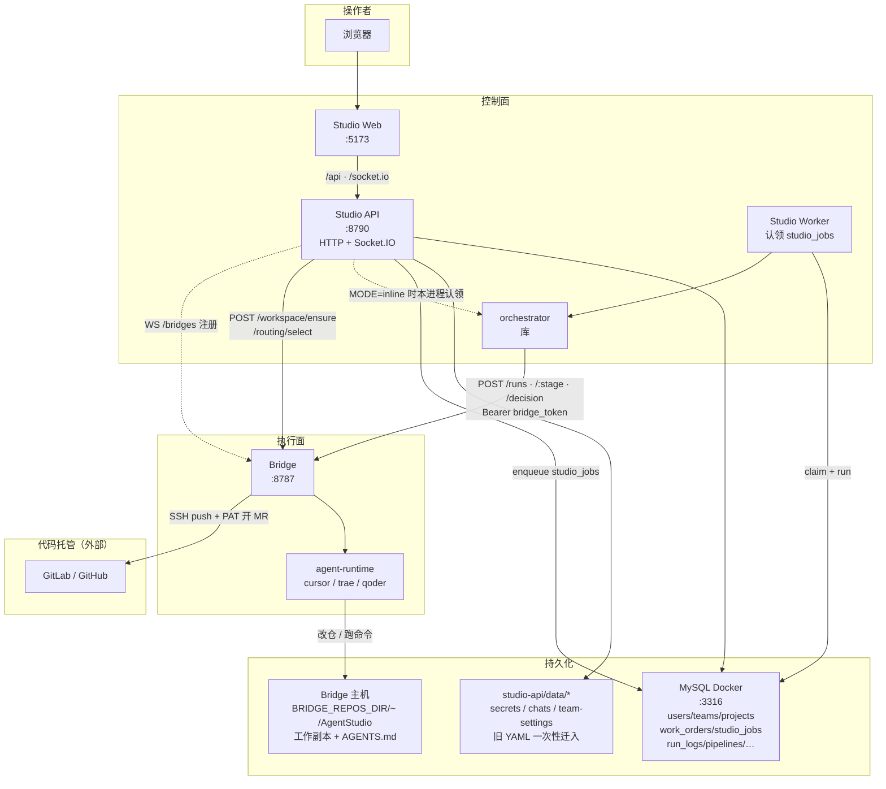
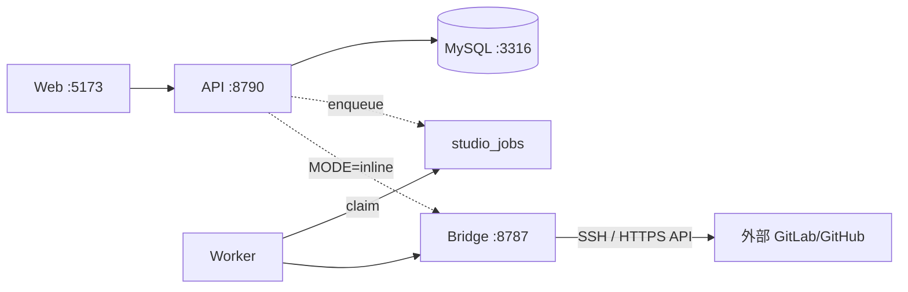
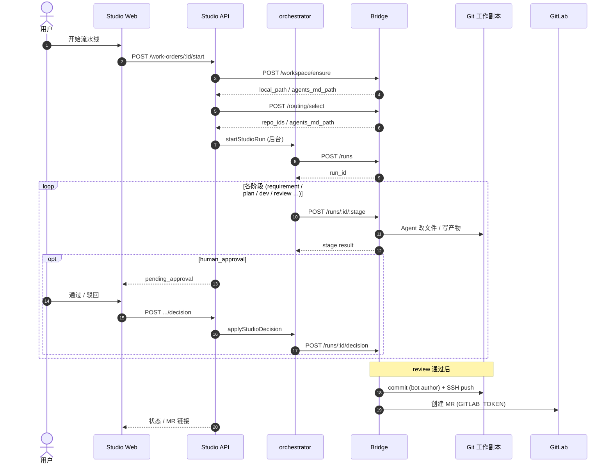
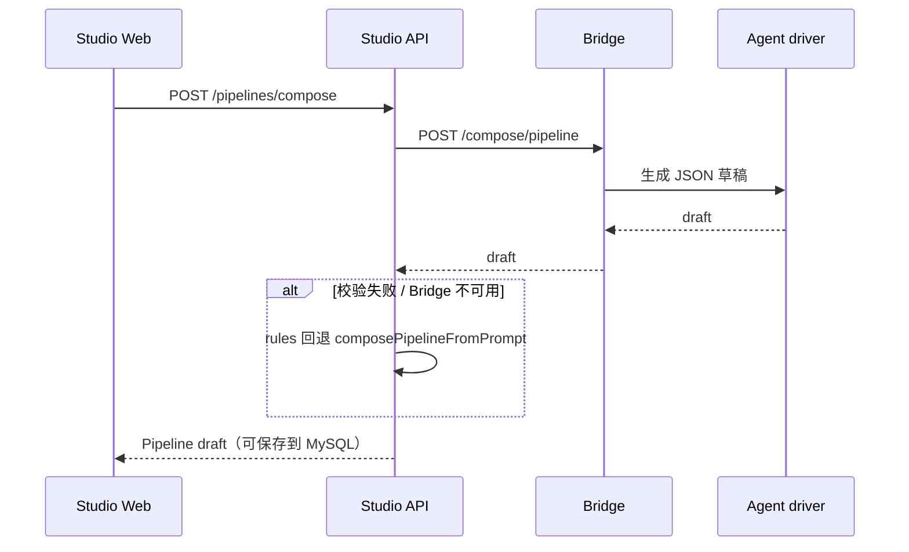
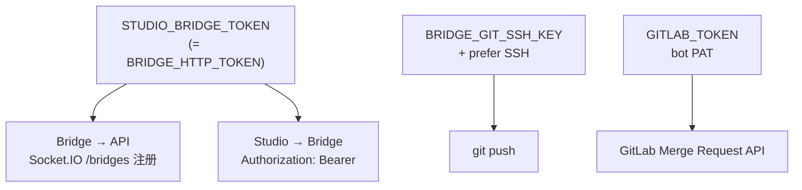
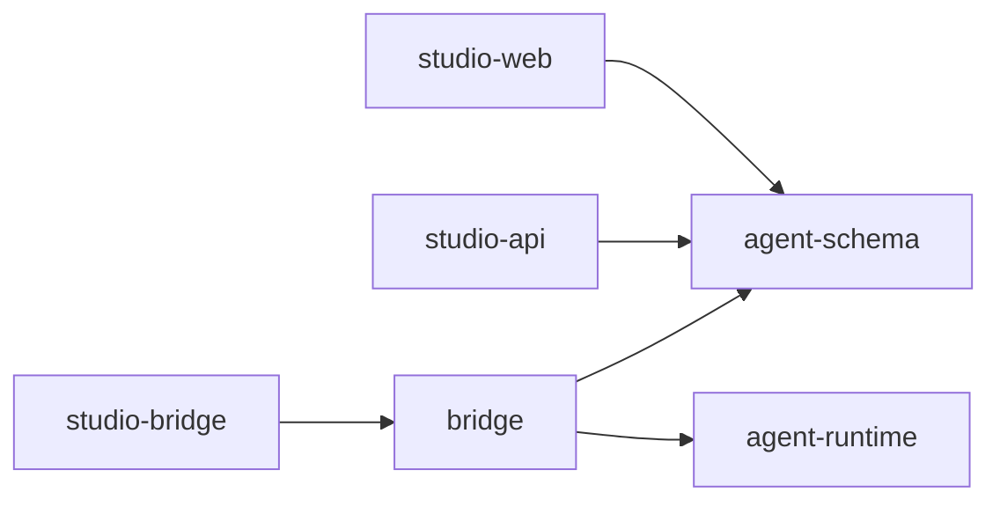

# Agent Studio — 架构与时序图

控制面（Studio）与执行面（Bridge）分离；**Studio orchestrator**（`packages/orchestrator`）负责任务编排与人工闸门；**外部** GitLab / GitHub 托管代码与 MR（可选）。`v2` 已去掉控制面 Dify 与仓库内置 GitLab Compose。

相关文档：[环境配置指南](./环境配置指南.md) · [对接外部Git](./对接外部Git.md) · Skill [`skills/local-stack-setup`](../skills/local-stack-setup/)

---

## 1. 系统架构（组件）



| 组件 | 职责 | 代码位置 |
|------|------|----------|
| Studio Web | 登录 / 选团队 / 工单 / 流水线 / 项目 / 设置 | `apps/studio-web` |
| Studio API | 鉴权、CRUD、入队 `studio_jobs`、实时推送 | `apps/studio-api` |
| Studio Worker | 认领并执行编排长任务（可选独立进程） | `apps/studio-api` `worker.main.ts` |
| MySQL | 用户/团队/项目/工单/任务队列/运行日志/流水线/数字人/Bridge | `deploy/mysql` + `sql/init.sql` |
| Bridge | 工作区 clone、阶段执行、选仓、compose、commit/push/MR | `packages/bridge` |
| orchestrator | 按流水线步骤调 Bridge stages + 人工闸门 | `packages/orchestrator` |
| agent-runtime | 可插拔 Agent 驱动 | `packages/agent-runtime` |
| GitLab / GitHub | remote / SSH / MR API（外部；本仓库不内置） | Bridge `.env` |

---

## 2. 部署与端口



| 端口 | 服务 |
|------|------|
| **3316** | **MySQL（Docker，推荐）** |
| 5173 | Studio Web（代理 `/api`、`/socket.io`） |
| 8790 | Studio API |
| — | Studio Worker（无 HTTP；`npm run dev:worker`） |
| 8787 | Bridge（`/health` 公开；其余需 Bearer） |

编排模式（`apps/studio-api/.env`）：

- `STUDIO_ORCHESTRATOR_MODE=inline`（默认）：API 进程认领 `studio_jobs`，单进程即可。
- `STUDIO_ORCHESTRATOR_MODE=worker`：API 只入队；另开 `npm run dev:worker` 执行长任务。

---

## 3. 工单主路径时序（Studio 编排器）



要点：

1. **工作区**由 Bridge `POST /workspace/ensure` 准备（`BRIDGE_REPOS_DIR`），再 **选仓** `POST /routing/select`；`routing_mode=explicit`。  
2. Studio → Bridge 调用带 `Authorization: Bearer`（`STUDIO_BRIDGE_TOKEN`）。  
3. Human Input 在 Studio 审批，经 orchestrator 调 Bridge `/decision`。  
4. Push 用 **SSH bot key**；开 MR 用 **bot PAT**（与 push 凭证分离）。  
5. 产物目录名可能仍为 `docs/dify-runs/{run_id}/`（历史路径）。

---

## 4. 流水线自然语言生成（compose）



（已移除）`pipelines/:id/dify-import` — 控制面不再导入 Dify DSL。

---

## 5. 鉴权关系



| 密钥 | 用途 |
|------|------|
| `STUDIO_BRIDGE_TOKEN` | Bridge HTTP + WS 注册；Studio 调 Bridge |
| `GITLAB_TOKEN` | 开 MR |
| `BRIDGE_GIT_SSH_*` | clone/push SSH |
| `CURSOR_API_KEY` 等 | Bridge 侧 Agent 驱动 |

---

## 6. 数据落盘

```text
MySQL (Docker :3316 / DB agent_studio)
  users, teams, team_members, projects
  work_orders, run_logs, run_log_entries
  digital_humans, pipelines, bridges

apps/studio-api/data/
  agents/              旧数字人 YAML（一次性迁入；可归档删除）
  pipelines/           旧流水线 YAML（一次性迁入；可归档删除）
  projects/            旧项目 YAML（一次性迁入；可归档删除）
  work-orders/         旧工单 YAML（一次性迁入；可归档删除）
  run-logs/            旧运行日志文件（一次性迁入；可归档删除）
  bridges/             旧执行器 YAML（一次性迁入；可归档删除）
  team-settings/       按团队的语言等设置（仍为文件）
  team-secrets/        按团队 Bridge/Git overlay（0600）
  work-order-chats/    工单总管聊天（仍为文件）
  studio-config.yaml   安装级设置（bridge_base_url / language / git）

Bridge 主机 BRIDGE_REPOS_DIR（默认 ~/AgentStudio）/{project.id}/{repo.id}/
  AGENTS.md
  docs/dify-runs/{run_id}/…   # 历史目录名；Bridge run 产物
```

---

## 7. 包依赖（Monorepo）


