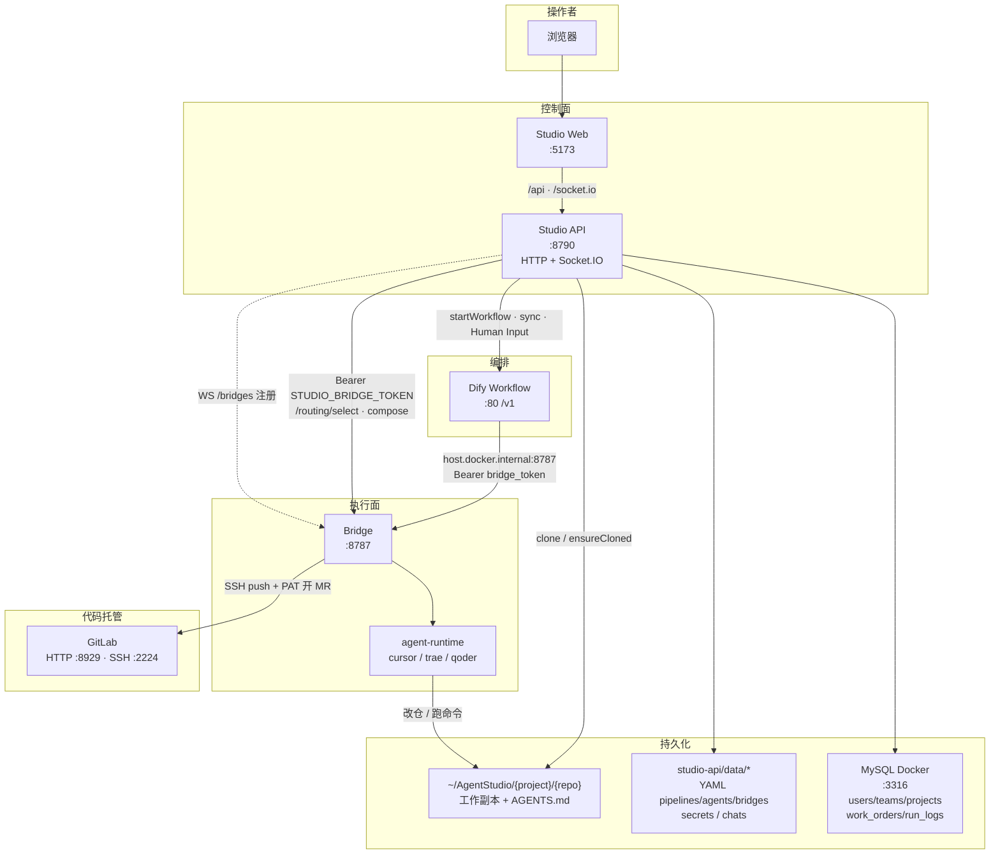
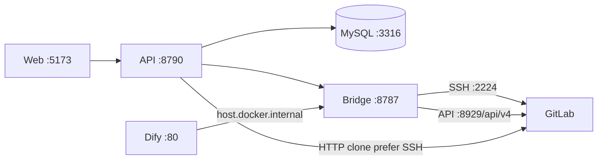
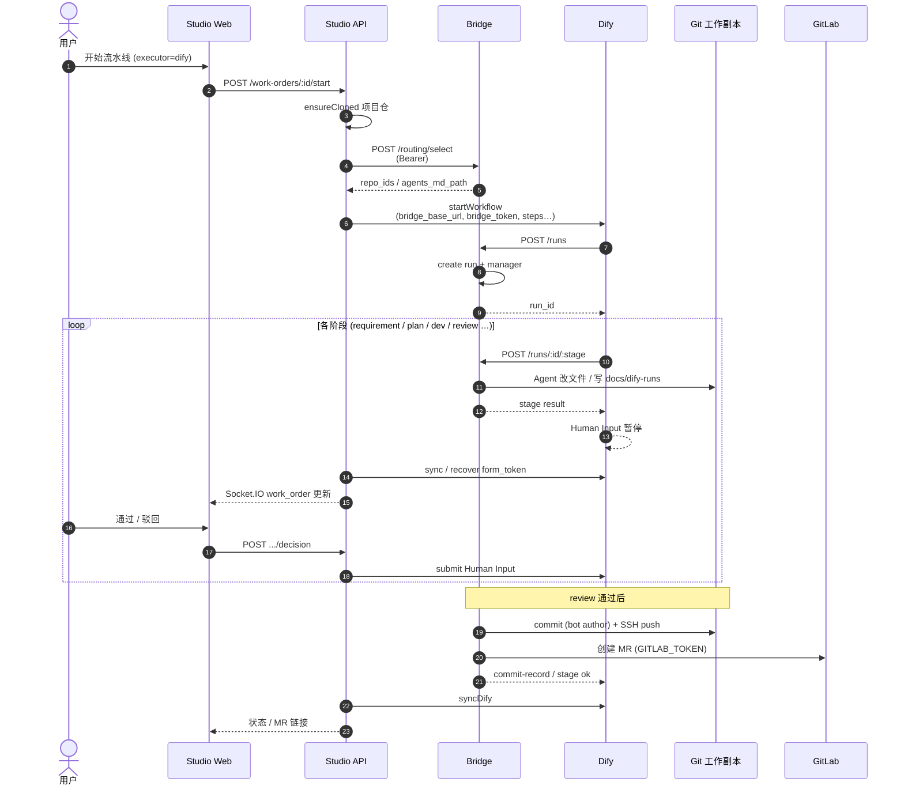
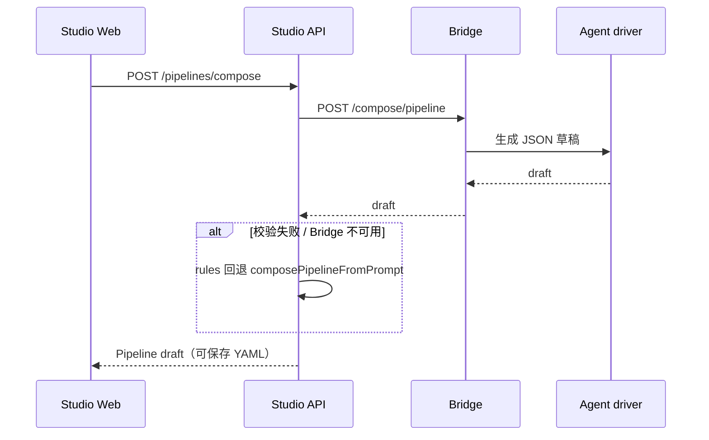
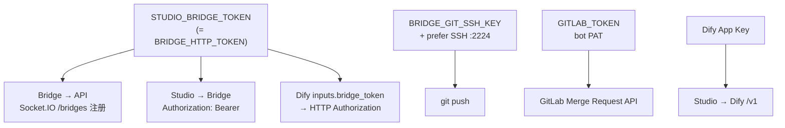
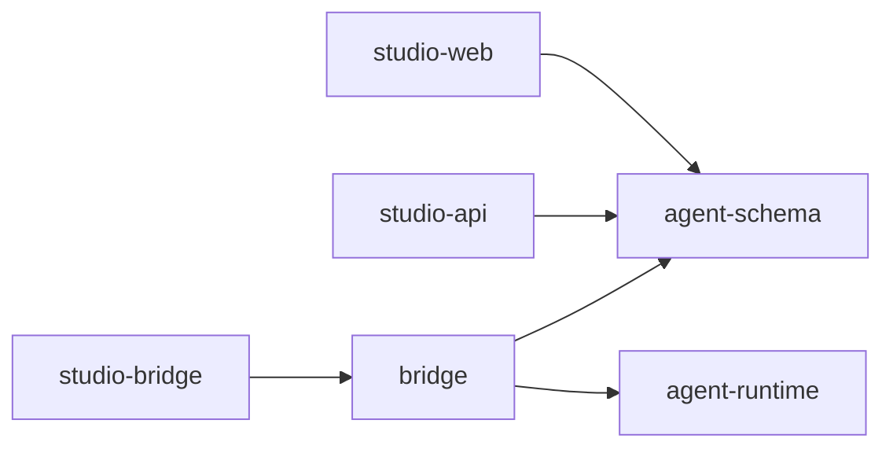

# Agent Studio — 架构与时序图

控制面（Studio）与执行面（Bridge）分离；Dify 负责任务编排与人工闸门；GitLab 托管代码与 MR。

相关文档：[环境配置指南](./环境配置指南.md) · [本地 Dify 与 GitLab](./本地Dify与GitLab搭建指南.md) · Skill [`skills/local-stack-setup`](../skills/local-stack-setup/)

---

## 1. 系统架构（组件）



| 组件 | 职责 | 代码位置 |
|------|------|----------|
| Studio Web | 登录 / 选团队 / 工单 / 流水线 / 项目 / 设置 | `apps/studio-web` |
| Studio API | 鉴权、CRUD、启动工单、Dify 客户端、克隆、实时推送 | `apps/studio-api` |
| MySQL | 用户/团队/项目/工单/运行日志 | `deploy/mysql` + `sql/init.sql` |
| Bridge | 阶段执行、选仓、compose、commit/push/MR | `packages/bridge` |
| agent-runtime | 可插拔 Agent 驱动 | `packages/agent-runtime` |
| Dify | Workflow 编排 + Human Input | `deploy/dify`（官方 1.16.1） |
| GitLab | remote / SSH / MR API | `deploy/gitlab` |

---

## 2. 部署与端口



| 端口 | 服务 |
|------|------|
| **3316** | **MySQL（Docker，推荐）** |
| 5173 | Studio Web（代理 `/api`、`/socket.io`） |
| 8790 | Studio API |
| 8787 | Bridge（`/health` 公开；其余需 Bearer） |
| 80 | Dify |
| 8929 | GitLab HTTP / API |
| 2224 | GitLab SSH → 容器 22 |

---

## 3. 工单主路径时序（Dify 执行器）



要点：

1. **选仓**在进 Dify 之前由 Studio 调 Bridge `/routing/select` 完成，并设 `routing_mode=explicit`。  
2. Dify 图里的 HTTP 节点必须带 `Authorization: Bearer {{bridge_token}}`。  
3. Human Input 需 **Web App** 投递，Studio 才能拿到 `form_token`（前端会自动 sync）。  
4. Push 用 **SSH bot key**；开 MR 用 **bot PAT**（与 push 凭证分离）。

---

## 4. 流水线自然语言生成（compose）



导入 Dify：`pipelines/:id/dify-import` → Console DSL 导入并 **publish**（需 Console Token）。

---

## 5. 鉴权关系



| 密钥 | 用途 |
|------|------|
| `STUDIO_BRIDGE_TOKEN` | Bridge HTTP + WS 注册；Studio/Dify 调 Bridge |
| `GITLAB_TOKEN` | 开 MR |
| `BRIDGE_GIT_SSH_*` | clone/push SSH |
| `DIFY_API_KEY` / `dify-secrets.yaml` | 启动/同步 Workflow |
| `CURSOR_API_KEY` 等 | Bridge 侧 Agent 驱动 |

---

## 6. 数据落盘

```text
MySQL (Docker :3316 / DB agent_studio)
  users, teams, team_members, projects
  work_orders, run_logs, run_log_entries

apps/studio-api/data/
  agents/              数字人 YAML（team_id）
  pipelines/           流水线 YAML（team_id；含 dify 绑定）
  projects/            旧 YAML（一次性迁入 MySQL 后可保留）
  work-orders/         旧工单 YAML（一次性迁入）
  run-logs/            旧运行日志文件（一次性迁入）
  bridges/             已注册执行器 YAML（team_id）
  team-settings/       按团队的语言等设置
  chats/               工单总管聊天（仍为文件）
  dify-config.yaml     非密钥 Dify 配置（安装级）
  dify-secrets.yaml    App Key / Console token（0600）

~/AgentStudio/{project.id}/{repo.id}/
  AGENTS.md
  docs/dify-runs/{run_id}/…
```

---

## 7. 包依赖（Monorepo）


